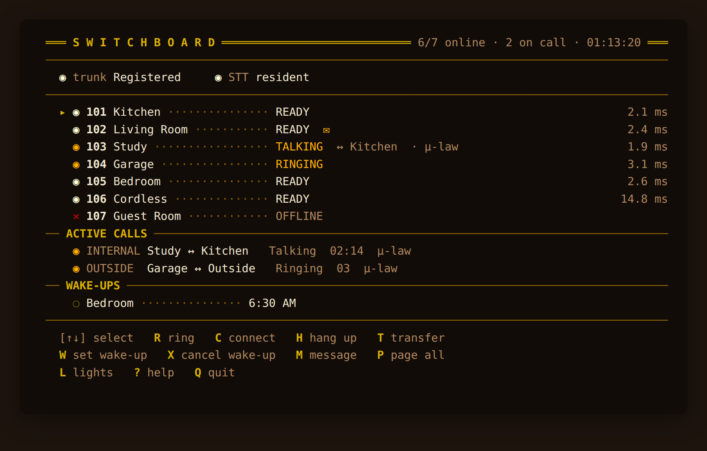

# The operator console (SSH + browser)

A live switchboard board an operator can drive by keystroke: see every phone's
status, **ring** a room, **connect** two rooms (patch a call), **hang up**,
**transfer**, **set/cancel a wake-up**, toggle **message-waiting**, **page all**,
and control **lights**. The board fills the whole terminal: each room row shows its
registration, any live call + peer, and its idle **round-trip latency** (RTT); a
status line under the header shows the **SIP trunk registration** (Registered /
Unregistered) and **resident-STT health** (resident / CLI-fallback) — the same
signals the Ingress dashboard surfaces. Three front-ends onto the same board:



- **In the Home Assistant sidebar** *(recommended, added in 0.93.0)* — open the
  **Switchboard** panel and press **Console**, or go straight to `/console/`
  under the panel's URL. This is the same board, served from the Ingress port, so
  **Home Assistant's own login is the only login** — there is no separate
  password to configure, forget, or leave switched off. The port does listen on
  your LAN — host networking gives it no choice — but every connection whose peer
  is not the Supervisor is refused, apart from three narrow HTTP exceptions that never
  reach the console ([Security](security.md)). It works in the HA mobile app.

  Two things worth knowing about it. The URL must end in a **slash**: the page
  loads its assets relatively, so `/console` alone resolves them one directory up
  and you get a terminal that never finishes connecting. `/console` redirects to
  `/console/` for you, and the page now says so plainly if the assets are
  missing. And because it is served inside the Home Assistant frontend, the
  terminal shares HA's browser *origin* — a scripting bug in this page would be a
  bug against your HA session, not merely against a terminal on its own port. The
  page is served only `xterm.js` and `xterm.css`, from a two-entry allowlist, for
  that reason.

- **Browser sign-in** *(the standalone `:8100` terminal only)* — when
  `console_users` is configured that terminal first shows a sign-in page; its
  socket also requires the signed-in session, and repeated failures from one
  address are throttled. The sidebar console above needs none of this.
- **SSH** — `ssh -p 2300 <user>@<ha-host>`, as a `console_users` entry: its
  username, then its password at the prompt. **While `console_users` has no valid
  entry, every login is refused**; the add-on log says so at start-up and once for
  each connection that tries. Keys: **↑↓ / j k** move, **R** ring,
  **C** connect, **H** hang up, **T** transfer, **W** set wake-up (type a time —
  `7:30`, `quarter past six`, `noon`), **X** cancel wake-up, **M** message-waiting,
  **P** page all, **L** lights, **?** help, **Q** / Ctrl-C quit. The **lights**
  list scrolls with **↑↓** — it says how many lights are hidden above and below,
  and repeats the area heading when the view starts inside one (0.94.4). Since
  0.100.0 **the board itself scrolls the same way**: the roster follows the
  selection and says how many rooms are out of view. When the window is shorter
  still, the active-call and wake-up lists collapse to a count of what they are
  hiding — but the key bar at the bottom is never given up, which is what used to
  happen first, because the page was simply cut off at the terminal's last row.
  The window size comes from your SSH terminal and follows a resize. Toggle with
  `console_enabled`; `console_port` and `console_bind` set its port and interface.
  **Since 0.114.0 `console_bind` defaults to `0.0.0.0`** — on a *fresh* install;
  an upgrade keeps the `console_bind` it had saved, most likely `127.0.0.1`, which
  leaves SSH reachable from the Home Assistant host only. The start-up line names
  the address it is actually listening on, so read that rather than assuming the
  new default applied, and set `console_bind: 0.0.0.0` to reach it from the LAN.

  The first connection asks you to accept the server's host key. Compare the
  fingerprint your client shows with the add-on log, which repeats it on a
  start-up line at every start:

  ```text
  [switchboard-console-ssh] SSH operator console listening on 0.0.0.0:2300 — host key SHA256:… (ssh-ed25519) — …
  ```

  The ed25519 key is created on first start at `/data/ssh_host_ed25519_key` and
  reused after every restart and update. If it is ever replaced (the file was
  deleted, or was not a usable key), clients warn that the host identification has
  changed: check the new fingerprint against the log, then drop the old one with
  `ssh-keygen -R "[<ha-host>]:2300"`.

  Only the interactive console is offered. Login is by password, never by key;
  running a command (`ssh … <command>`), sftp and scp, port forwarding, and agent
  or X11 forwarding are all refused, and the connection closes when the console
  is quit. A connection has 60 s to log in and is closed after 15 minutes without
  input. Wrong passwords are throttled per address — 5 attempts in any 5 minutes,
  at most 3 on one connection — separately from the web terminal's count. A
  `console_users` entry holding a character an SSH client cannot send (a control
  character, say) cannot log in over SSH; the start-up log counts such entries.
  Recent OpenSSH clients warn that the connection "is not using a post-quantum
  key exchange algorithm". That is expected: the SSH library in the add-on
  (asyncssh) offers post-quantum key exchange only with liboqs, which the image
  does not include. `-o WarnWeakCrypto=no-pq-kex` silences the warning.
- **Browser web terminal (the standalone one)** — the same TUI rendered with
  xterm.js by a small stdlib HTTP + WebSocket server that bridges to the board
  over its Unix socket, `/run/switchboard/console.sock`. **Since 0.94.0 it binds
  to `127.0.0.1` by default**, so `http://<ha-host>:8100/` does not answer from
  another machine; it is kept as a fallback reachable from the Home Assistant host
  itself. A blank `console_web_bind` also means `127.0.0.1` (since 0.114.0 it no
  longer follows `console_bind`). The sidebar console above supersedes it and
  needs no `console_users` entry. Toggle with `console_web_enabled` /
  `console_web_port`; since 0.114.0 it keeps running when `console_enabled` is off.

The board itself listens on no network port, only on the Unix socket
`/run/switchboard/console.sock` (mode 0600, root), and all three front-ends
connect to it there. The sidebar console and the web terminal work whatever
`console_enabled` is set to. Only with `console_enabled` and `console_web_enabled`
both `false` does the board stop, and the sidebar console then shows
"unavailable".

> **Security:** all three front-ends can ring, connect and hang up phones, and
> they are *not* equally exposed.
>
> - **The sidebar console is the one to use.** It is served on the Ingress port,
>   so Home Assistant has already authenticated the caller before anything reaches
>   the add-on, and a guard pins the connection to the Supervisor — for HTTP *and*
>   for the terminal's WebSocket. The port does listen on your LAN — host
>   networking gives it no choice — but every connection whose peer is not the
>   Supervisor is refused, apart from three narrow HTTP exceptions that never
>   reach the console ([Security](security.md)), and there is no second password to configure or leave
>   switched off.
> - **SSH (2300)** asks every connection for a `console_users` password and
>   refuses every login while that list has no valid entry; there is no key,
>   anonymous or default login. That is why `console_bind` defaults to every
>   interface since 0.114.0. Connections are capped at 16, and 4 per address,
>   before the SSH handshake; failed passwords are throttled per address; no log
>   line carries a username, a password or a command line. Set
>   `console_bind: 127.0.0.1` to keep it on the Home Assistant host.
> - **The standalone web terminal (8100)** binds to `127.0.0.1` by default since
>   0.94.0. It still supports a sign-in when `console_users` has an entry:
>   the page redirects to a login form, the `/ws` upgrade re-checks the session
>   cookie (so a saved socket URL is no way around it), sessions are 256-bit
>   tokens with a 12-hour lifetime dropped on restart, and failed attempts are
>   throttled per source address. With `console_users` **empty** the gate is off,
>   which is why the bind matters; the start-up log states which mode is live and
>   whether the bind actually exposes it.
>
> Independently of any login, **both** browser front-ends cap concurrent sessions
> at 5 and reclaim one after 15 minutes of browser idle; the sidebar console also
> has a 12-hour absolute ceiling per session. The standalone terminal additionally
> same-origin-gates its WebSocket upgrade, and its bind is `console_web_bind`
> (`127.0.0.1` by default, and when blank). SSH has its own caps, listed above. See
> [SECURITY.md](../../SECURITY.md).

---
