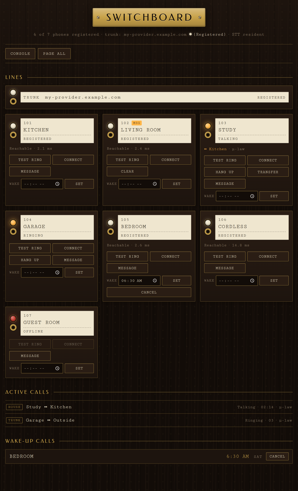

# Quick start

1. **Install** the add-on (you already did if you're reading this from the add-on's
   Documentation tab).
2. Open the **Configuration** tab and define one entry under `rooms` per phone,
   each with a unique extension, a friendly name, and a **secret** (the password
   the Grandstream port will use to register). **Replace the `change-me-…`
   placeholder secrets.**
3. **Start** the add-on. Watch the **Log** tab; you should see
   `switchboard-config` render the configuration (look for
   `codecs: u-law only (no transcoding)` near the end, closing with
   `done: N room(s), trunk=…`), then Asterisk start.
4. **Provision the gateway** ([Grandstream GXW4216 V2 provisioning](gxw4216-gateway.md)) so
   each FXS port registers.
5. Open the **Switchboard** panel in the Home Assistant sidebar (Ingress) — each
   room flips to **Registered** as its port comes online.
6. Pick up a phone and dial another room's extension. Done.

The dashboard also carries a **Lights panel**: every Home Assistant light the add-on can see, grouped by area, with on/off toggles — the same control the voice menu on `43` offers, for when you would rather tap than talk.

Changing options and restarting the add-on regenerates the entire Asterisk
configuration — **the add-on options are the source of truth.** Editing
`/etc/asterisk/*.conf` by hand is pointless; every file is overwritten on start.

---
